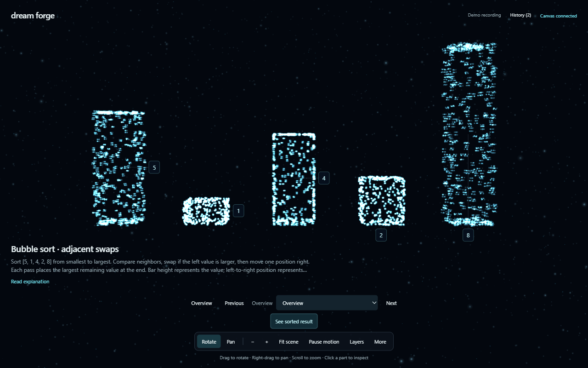
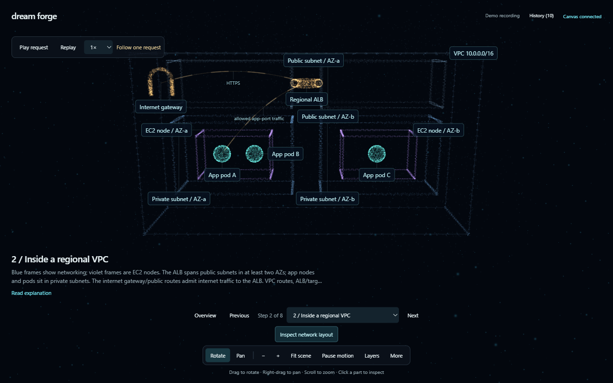

# Dream Forge

**Give your agent a space where ideas take shape.**

Dream Forge gives Codex, Claude Code, and other tool-using agents a local, interactive 3D particle canvas. Dots assemble into an explanation; follow-up scenes morph or dissolve into new constructs. Explore parts, rotate the view, follow steps, and revisit saved history.

[](https://github.com/sbalasubramanian14/dream-forge/actions/workflows/test.yml)
[](https://github.com/sbalasubramanian14/dream-forge/releases)
[](LICENSE)



[Watch/download the UI recording](https://github.com/sbalasubramanian14/dream-forge/releases/download/v0.6.0/demo.webm) · [Alphabet](docs/media/alphabet.png) · [Solar system](docs/media/solar-system.png) · [Multi-region EKS](docs/media/aws-eks.png)

The recording shows the shipped application: particle formation, adjacent swaps, step navigation, a solar system, and component inspection. These are authored illustrations, not physical simulations or live traces.

## Install for your agent

Requirements: **Node.js 22+**, npm, Git, and a browser with WebGL/hardware acceleration. Install the Codex or Claude Code CLI separately and make it available on PATH. Dream Forge needs no API key; your agent uses its own authentication.

```sh
git clone --branch v0.6.0 --depth 1 https://github.com/sbalasubramanian14/dream-forge.git
cd dream-forge
```

You can also download the source ZIP from [the release](https://github.com/sbalasubramanian14/dream-forge/releases/tag/v0.6.0), extract it, and run setup from that folder. Git is only needed for the clone/update workflow.

Choose your agent:

| Agent       | Setup                          | Check connection                        |
| ----------- | ------------------------------ | --------------------------------------- |
| Codex       | `node scripts/setup.js codex`  | `node bin/dream-forge.js doctor codex`  |
| Claude Code | `node scripts/setup.js claude` | `node bin/dream-forge.js doctor claude` |
| CLI only    | `node scripts/setup.js cli`    | `node bin/dream-forge.js doctor`        |

Setup runs `npm ci`, registers the stdio MCP server through the agent's own CLI using absolute Node/repository paths, and installs its user skill. The skill receives an `installation.json` with exact local paths, avoiding filesystem searches. Existing skill copies or registrations pointing elsewhere require `--update`. An already-correct MCP registration is retained. Run both setup commands if you use both agents.

Your host may ask you to approve the first canvas write. For trusted, uninterrupted local drawing in Codex, opt in explicitly with `node scripts/setup.js codex --approve-canvas` (add `--update` for an existing installation). This approves only Dream Forge's local canvas/session/camera/step/history tools in Codex config; it does not change approvals for other servers or shell commands. Without it, your existing host policy applies. Noninteractive Codex sessions with approval policy `never` need prior approval for write tools. Claude Code uses its own first-use approval UI.

**Restart your agent session**, then ask:

> Use Dream Forge to show A through Z in a fresh canvas. Give me its URL.

Or:

> Use Dream Forge to explain bubble sort with clickable comparisons and swaps.

Open the returned `http://127.0.0.1:4317/?session=...` URL. MCP starts the server automatically. Each conversation should create one explicit session and reuse its ID. New canvases begin empty; subsequent explanations preserve bounded history.

This release is a **GitHub-distributed CLI + MCP server + skills**. It does not install a marketplace plugin and is not published on npm. Keep the clone at a permanent location: MCP points to it. Setup does not install the agent or sign you in. Existing chats may need reconnecting before they discover new tools.

To let another developer's agent install it, share this prompt:

> Install https://github.com/sbalasubramanian14/dream-forge for this agent using its tagged release and README setup command. Run doctor, tell me if a restart is needed, then show A–Z in a fresh Dream Forge canvas. Use the installed skill and the built-in text tool rather than writing a glyph generator.

The agent needs shell/network access and its host's normal permission to modify local configuration.

## What the pieces do

| Piece   | Purpose                                                                   |
| ------- | ------------------------------------------------------------------------- |
| MCP     | Tools for drawing, text, camera control, interactions, state and history. |
| CLI     | The local scene workflow through shell commands, useful without MCP.      |
| Skill   | Guidance for the scene contract, validation, isolation and presentation.  |
| Browser | The human's interactive particle canvas.                                  |

Codex can invoke `$dream-forge`; Claude Code can invoke `/dream-forge`. You can also say “use Dream Forge.” A skill alone does not install dependencies or configure MCP.

For short text, the agent uses `create_session` then `show_text`. Glyphs are generated and validated internally, and the result is compact. No schema lookup, custom generator, or full point-cloud response is needed. Text supports A–Z, digits, spaces, newlines and `- . ? !`; lowercase becomes uppercase. Complex explanations still require agent-authored geometry and validation, so their generation time varies.

## Try it without an agent

After CLI setup, run this in one terminal and keep it open:

```sh
node bin/dream-forge.js start
```

In another terminal, from the clone:

```sh
node bin/dream-forge.js session new "My first explanation"
node bin/dream-forge.js text "ABCDEFGHIJKLMNOPQRSTUVWXYZ" --session YOUR_SESSION_ID
node bin/dream-forge.js demo bubble-sort --session YOUR_SESSION_ID
```

Replace `YOUR_SESSION_ID` with the returned ID and open its URL. `text` replaces the canvas with particle letters; `demo` then replaces them with the walkthrough. **Next** follows the swaps. Amber means compare, red means swap needed, and green means final position. **Read explanation** opens the complete text.

Other demos: `portal`, `tree`, `mechanism`, `orbits`, `rocket`, `architecture`, `helix`, `solar-system`, `walkthrough`, and `aws-eks`.



## Explore a construct

- Rotate/Pan, drag and scroll to change your view. **Fit scene** frames visible objects.
- Click geometry or a label to inspect without moving the camera. **Zoom to selection** moves closer.
- Drag labels to reposition them; filter with **Layers** and focus a hierarchy with **Isolate selection**.
- Next/Previous, the step picker and arrow keys follow authored explanations. Request journeys have playback controls.
- **History** restores snapshots. **Pause motion** freezes motion, transitions and playback. Reduced-motion preferences start paused.

Dream Forge uses procedural point clouds and particle morphing, not Gaussian-splat reconstruction or arbitrary text-to-3D generation. Scenes and actions are validated data, never executable JavaScript or HTML. A notify button records intent; it does not automatically wake an agent.

## Check your connection

```sh
node bin/dream-forge.js doctor codex
# Or: doctor claude. Omit the agent for a standalone runtime check.
```

Doctor checks the selected agent's registration and user skill, then exercises a disposable MCP process on a temporary port: handshake, tools, capabilities, validation, scene delivery and browser assets. Persistence is disabled and the process is closed afterward. Saved canvases are untouched. It also reports the main server's availability/version.

Doctor does not launch a model request, inspect the active host tool list, or test your GPU. Open the session URL to verify graphics and reconnect the agent to load newly registered tools. A project-only skill can be checked manually; the agent-specific doctor checks user installation.

## Manual setup and other MCP clients

After `npm ci`, register without reinstalling dependencies:

```sh
node bin/dream-forge.js setup codex
# Or: setup claude
```

Other clients can use this JSON, replacing the path:

```json
{
  "mcpServers": {
    "dream-forge": {
      "command": "node",
      "args": ["/absolute/path/to/dream-forge/bin/dream-forge.js", "mcp"]
    }
  }
}
```

Windows paths such as `C:/dev/dream-forge/bin/dream-forge.js` work. Client configuration locations differ. Use `mcp`, not `start`, as the stdio argument.

For project-local skills, run from the project you want to equip:

```sh
node /absolute/path/to/dream-forge/bin/dream-forge.js install-skill codex project
# Or: install-skill claude project
```

User skills live at `~/.agents/skills/dream-forge` for Codex and `~/.claude/skills/dream-forge` for Claude Code. Project copies use the same subfolders under the target project. `npm link` in the clone optionally exposes `dream-forge` on PATH.

## Update

Stop the server before changing versions. This interrupts all canvases on its port but preserves saved history:

```sh
node bin/dream-forge.js stop
git fetch origin --tags
git checkout v0.6.0
node scripts/setup.js codex --update
node bin/dream-forge.js doctor codex
```

Use the desired tag from [Releases](https://github.com/sbalasubramanian14/dream-forge/releases) in place of `v0.6.0`, and `claude` for Claude Code. Update both agents if installed. CLI-only installations use `setup.js cli`.

Setup refreshes bundled skill files and installation paths, preserving unrelated files. It replaces an MCP registration pointing elsewhere only with `--update`; correct existing registrations retain their environment. Refresh project-local skills separately with `install-skill <agent> project --update` from each project. Review/commit local changes before switching tags. For development, use a regular main-branch clone and `git pull --ff-only`.

Restart the agent's MCP connection and refresh browser tabs after updating.

## Uninstall

Stop the canvas, then remove the registration from clients you configured:

```sh
node bin/dream-forge.js stop
codex mcp remove dream-forge
claude mcp remove --scope user dream-forge
```

Run only relevant agent commands. Claude project registrations use `--scope project` from that project. Restart the agent afterward.

Remove only the installed Dream Forge skill folders. Save your own notes from those folders first. On macOS/Linux:

```sh
rm -r "$HOME/.agents/skills/dream-forge"
rm -r "$HOME/.claude/skills/dream-forge"
```

On Windows PowerShell:

```powershell
Remove-Item -LiteralPath (Join-Path $HOME '.agents/skills/dream-forge') -Recurse
Remove-Item -LiteralPath (Join-Path $HOME '.claude/skills/dream-forge') -Recurse
```

Remove project copies where installed. If you used `npm link`, run `npm unlink --global @sbalasubramanian14/dream-forge`. Then delete the clone if desired.

Saved canvases remain under `~/.dream-forge/<port>/` or your configured data directory. Keep them for reinstalling; deliberately deleting that directory removes scenes/history. Unregistering MCP or deleting a skill leaves saved data intact.

## Configuration and troubleshooting

| Setting                | Default          | Use                                                                                                                                   |
| ---------------------- | ---------------- | ------------------------------------------------------------------------------------------------------------------------------------- |
| `DREAM_FORGE_PORT`     | `4317`           | Set before setup for a new registration, and on manual server/CLI processes. Correct existing registrations retain their environment. |
| `DREAM_FORGE_DATA_DIR` | `~/.dream-forge` | Persistence parent directory in the server's environment.                                                                             |
| `DREAM_FORGE_PERSIST`  | `1`              | Set `0` for temporary canvases.                                                                                                       |
| `DREAM_FORGE_SESSION`  | `local` for CLI  | Dedicated shell's session; otherwise pass `--session ID`.                                                                             |

- **Agent command missing:** install its CLI and reopen the terminal, or use CLI-only setup.
- **Tools missing:** run doctor, check the client's MCP list, and restart/reconnect.
- **Old server version:** stop it, then reconnect MCP or run `start` again. Saved history remains.
- **Port occupied:** stop the conflicting application or use another port. Other applications/versions are not silently reused.
- **Blank graphics:** enable hardware acceleration/WebGL and inspect the browser console. Doctor cannot verify GPU support.
- **Skill but no tools:** configure MCP or use the CLI; the skill provides instructions.
- **Install fails:** npm needs network access and a writable clone. Setup stops on dependency failure.

The server binds to `127.0.0.1`, rejects foreign Host/Origin headers, and makes no runtime cloud requests or telemetry. Other trusted local processes can access it; this is not an authenticated multi-user service. npm needs network access for installation.

## Reference and development

[Scene contract, tools and API](docs/scene-reference.md) · [Development and headed tests](docs/development.md) · [Changelog](CHANGELOG.md) · [Contributing](CONTRIBUTING.md) · [Agent conventions](AGENTS.md)

Limits: 24 objects, 48 connections, 20 steps and a 1 MiB compact JSON scene payload. History retains up to 50 snapshots and 16 MiB per session. Large scenes share a fixed particle budget, and the last accepted same-session update wins. Imported meshes/splats, physical simulation and arbitrary semantic object generation are not implemented.

CI checks runtime tests and formatting on Windows/Linux with Node 22; headed browser tests run on Linux. Local visual verification uses headed Chromium on Windows. macOS has not been independently tested. This is an early developer release; report reproducible problems through [GitHub Issues](https://github.com/sbalasubramanian14/dream-forge/issues).

Integration references: [Codex MCP](https://developers.openai.com/codex/mcp), [Codex skills](https://developers.openai.com/codex/skills), [Claude Code MCP](https://code.claude.com/docs/en/mcp), [Claude Code skills](https://code.claude.com/docs/en/skills).

MIT licensed.
