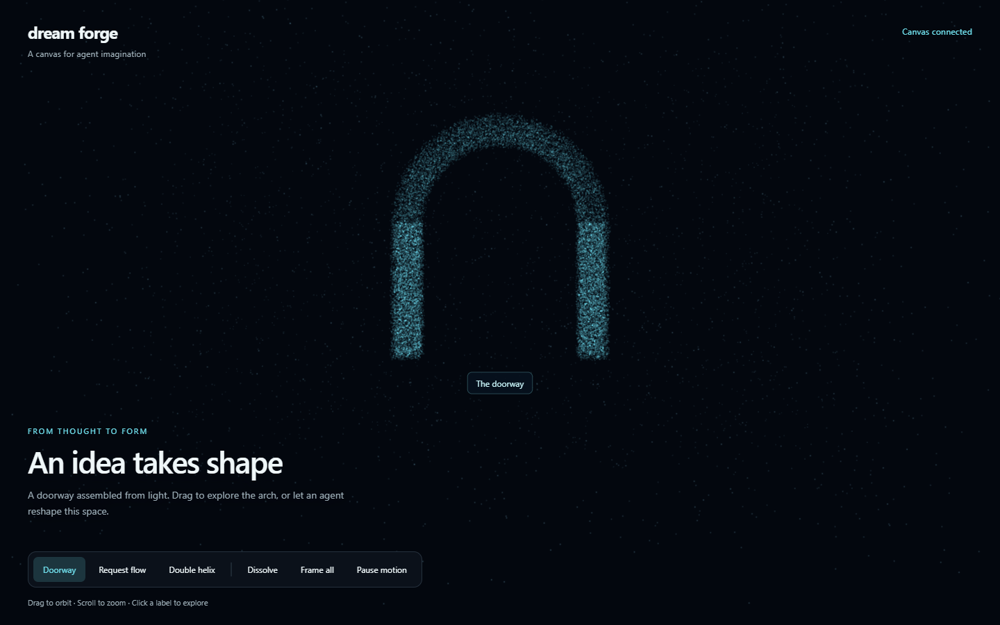

# Dream Forge

**Give your agent a space where ideas take shape.**

Dream Forge is a local 3D particle canvas for AI explanations. It begins as a field of dots. Codex, Claude Code, or another tool-using agent sends a structured scene, and the dots assemble into constructs. Follow-up explanations can reshape the scene, animate connections, or focus an object.

This first version uses procedural point clouds and particle morphing. It is not a Gaussian-splat reconstruction engine or an arbitrary text-to-3D model generator.



## Quick start

Requirements: Node.js 22 or newer, npm, Git, and a browser with WebGL enabled. No API key is required by Dream Forge. Your chosen agent runs separately with its own authentication.

```sh
git clone https://github.com/sbalasubramanian14/dream-forge.git
cd dream-forge
npm ci
npm start
```

Open **http://127.0.0.1:4317**. Keep the terminal running. Use the compact construct selector to explore **Stone doorway**, **Branching tree**, **Gear assembly**, **Planet system**, **Rocket**, **Request flow**, **Double helix**, or **Guided explanation**. Drag to orbit, scroll to zoom, and click an object label for details. **Reset view** resets camera zoom and rotation to fit every construct on screen. **Dissolve** returns to the idle field; **Pause motion** stops particle animation. Reduced-motion preferences start the canvas paused. Constructs stay centered and take most of the viewport. Small captions and controls sit along the bottom. Background dots cover the viewport independently of construct zoom.

In a second terminal, from the repository:

```sh
node bin/dream-forge.js demo architecture
node bin/dream-forge.js focus database
node bin/dream-forge.js focus all
node bin/dream-forge.js clear
```

## Connect an agent through MCP

Dream Forge exposes a **stdio MCP server**, not a hosted service. Configure the command with an **absolute path** to the cloned repository so it works from any project. The examples below use the Windows path where this project was created; replace it with your own path. On macOS/Linux, use a path such as `/Users/you/projects/dream-forge/bin/dream-forge.js`.

### Codex

```sh
codex mcp add dream-forge -- node "D:/aiprojects/dream-forge/bin/dream-forge.js" mcp
codex mcp list
```

Restart your Codex session after adding the server. Ask:

> Use Dream Forge to explain this application's architecture. Assemble the browser, API, and database, show the request flow, and give each construct a description.

### Claude Code

```sh
claude mcp add --transport stdio --scope user dream-forge -- node "D:/aiprojects/dream-forge/bin/dream-forge.js" mcp
claude mcp list
```

Restart Claude Code and use `/mcp` to check the connection. Then ask:

> Use Dream Forge to show how authentication works in this project. Build a labeled particle scene and focus each component as you explain it.

The MCP process starts the local canvas automatically if the port is free, or connects to a Dream Forge server already running there. Open the URL returned by a tool call. For a canvas that stays available independently of agent sessions, run `npm start` first.

### Other MCP clients

Use this stdio configuration, adjusting the path:

```json
{
  "mcpServers": {
    "dream-forge": {
      "command": "node",
      "args": ["D:/aiprojects/dream-forge/bin/dream-forge.js", "mcp"]
    }
  }
}
```

Clients have different configuration locations. The important parts are the command, absolute entrypoint, and `mcp` argument. Any agent with shell access can use the CLI instead.

## Install the optional agent skill

The skill teaches an agent how to choose constructs and preserve scene continuity. It complements MCP; it does not replace the renderer or install dependencies.

From **the project you want the agent to work in**, run:

```sh
node "D:/aiprojects/dream-forge/bin/dream-forge.js" install-skill codex project
node "D:/aiprojects/dream-forge/bin/dream-forge.js" install-skill claude project
```

This copies the skill into `.agents/skills/dream-forge/` for Codex or `.claude/skills/dream-forge/` for Claude Code. To install for all projects, replace `project` with `user`; this uses `~/.agents/skills/` or `~/.claude/skills/`. Existing skill folders are never overwritten automatically.

Restart the agent, then invoke `$dream-forge` in Codex or `/dream-forge` in Claude Code. MCP setup is still required if you want tool calls. For a shell-only workflow, run `npm link` in the Dream Forge repository once to make `dream-forge` available on PATH, or call the absolute Node entrypoint directly.

## CLI reference

| Command                                                     | Result                                            |
| ----------------------------------------------------------- | ------------------------------------------------- |
| `dream-forge start`                                         | Serve the browser canvas in the foreground        |
| `dream-forge mcp`                                           | Run the stdio MCP server and start/reuse a canvas |
| `dream-forge show scene.json`                               | Validate and replace the complete scene           |
| `dream-forge demo <name>`                                   | Display a bundled example                         |
| `dream-forge focus object-id`                               | Focus one construct                               |
| `dream-forge focus all`                                     | Frame all constructs                              |
| `dream-forge camera <view\|file.json> [zoom] [target-id]`   | Set camera view, zoom, target, or orbit           |
| `dream-forge clear`                                         | Dissolve into the idle particle field             |
| `dream-forge status`                                        | Print the current scene, focus, and revision      |
| `dream-forge install-skill <codex\|claude> [project\|user]` | Install agent guidance                            |

Without `npm link`, use `node bin/dream-forge.js` in place of `dream-forge` from the repository.

The default port is 4317. Set `DREAM_FORGE_PORT` on both the server and calling CLI/MCP process to change it:

```powershell
$env:DREAM_FORGE_PORT = "4320"
npm start
```

```sh
# macOS / Linux
DREAM_FORGE_PORT=4320 npm start
```

For a custom MCP port, add `--env DREAM_FORGE_PORT=4320` to `codex mcp add`, or `--env DREAM_FORGE_PORT=4320` to `claude mcp add`, before the `--` separator.

## Scene format

```json
{
  "title": "Follow a request",
  "explanation": "The browser calls the API, which queries storage.",
  "objects": [
    { "id": "browser", "shape": "box", "label": "Browser", "position": [-4, 0, 0] },
    { "id": "api", "shape": "sphere", "label": "API", "position": [0, 0, 0] },
    { "id": "db", "shape": "cylinder", "label": "Database", "position": [4, 0, 0] }
  ],
  "connections": [
    { "from": "browser", "to": "api", "label": "request" },
    { "from": "api", "to": "db", "label": "query" }
  ]
}
```

Supported shapes: `sphere`, `box`, `torus`, `cylinder`, `cone`, `arch`, `helix`, `tree`, `gear`, `rocket`, `ruins`, and `pointcloud`.

Each object has a unique `id` (letters, numbers, underscores, hyphens; maximum 64 characters), `shape`, optional `label`, `description`, `position` `[x,y,z]` (each coordinate -100 to 100), uniform `scale` (0.1 to 12), hex `color`, and Euler XYZ `rotation` in radians (default `[0,0,0]`). Defaults: position `[0,0,0]`, scale `1`, color `#70e0ed`, empty label and description. The Y axis points up.

Scenes support up to 24 objects and 48 connections. Connections reference existing object IDs and show directed particle flow from `from` to `to`. `show` replaces the entire scene. Preserve IDs and positions when expanding an explanation. Invalid scenes are rejected without changing the current scene. There is no arbitrary JavaScript execution in scene payloads.

For agent-defined geometry, use `shape: "pointcloud"` and provide `points`, an array of 1 to 12,000 local `[x,y,z]` coordinates (each coordinate -100 to 100). Scale and rotation are applied before the object is placed in the scene. The full JSON payload is limited to 1 MiB. Points are sampled across the fixed particle budget, so large clouds may be displayed at lower density.

```json
{
  "title": "A custom construct",
  "objects": [
    {
      "id": "custom",
      "shape": "pointcloud",
      "label": "Agent geometry",
      "points": [
        [-2, -1, 0],
        [2, -1, 0],
        [0, 2, 0],
        [0, 0, 1]
      ],
      "rotation": [0, 0.7, 0]
    }
  ]
}
```

Demo names: `portal`, `tree`, `mechanism`, `orbits`, `rocket`, `architecture`, `helix`, and `walkthrough`. Example JSON files are shared by the browser selector and CLI, so either interface produces the same scene.

## Agent camera control

Call `set_camera` through MCP, `POST /api/camera`, or the CLI:

```sh
node bin/dream-forge.js camera right 1.5
node bin/dream-forge.js camera isometric 1 tree
node bin/dream-forge.js camera camera.json
```

```json
{
  "view": "isometric",
  "target_id": "tree",
  "zoom": 1.2,
  "auto_rotate": true,
  "speed": 12,
  "transition": 0.8
}
```

Views: `front`, `back`, `left`, `right`, `top`, `bottom`, `isometric`. Optional absolute `yaw` (-360 to 360) and `pitch` (-89.5 to 89.5) are in degrees and override the preset. `target_id: null` fits the entire scene; an object ID fits that object. `zoom` ranges from 0.1 to 10 relative to automatic framing: 1 fits, 2 moves twice as close, 0.5 moves farther away. `speed` is orbit speed in degrees/second (-90 to 90), and `transition` sets the smoothing time scale (0 to 5 seconds; 0 snaps). Each command replaces camera settings. Manual dragging or zooming interrupts agent camera motion. Pause/reduced-motion settings stop auto-orbit. Scene replacement and Reset view restore default framing.

Background particles use a camera-local layer with fixed screen sizes, so zooming out continues to show particles even when the construct becomes tiny. The requested camera is returned in state; user-adjusted camera positions are local to each browser and are not reported as live pose feedback.

## Agent-authored buttons and guided steps

Try **Guided explanation** in the selector, or `node bin/dream-forge.js demo walkthrough`. An agent can author `actions` and up to 20 `steps` in a scene. Each step is a scene snapshot with its own objects, connections, title, explanation, optional camera, and optional actions. Missing step actions inherit the overview actions; `actions: []` removes them. The initial overview is step -1. Steps are zero-based.

```json
{
  "title": "Explore a mechanism",
  "objects": [{ "id": "gear", "shape": "gear", "label": "Gear" }],
  "actions": [
    {
      "id": "side",
      "label": "View its side",
      "placement": "object",
      "object_id": "gear",
      "action": {
        "type": "camera",
        "settings": { "view": "right", "target_id": "gear", "zoom": 1.2 }
      }
    },
    { "id": "next", "label": "Show the next step", "action": { "type": "next" } },
    {
      "id": "ask",
      "label": "Explain these teeth",
      "placement": "screen",
      "position": [0.85, 0.3],
      "action": { "type": "notify", "message": "Explain the gear teeth." }
    }
  ],
  "steps": [
    {
      "title": "The teeth transmit force",
      "objects": [{ "id": "gear", "shape": "gear", "label": "Gear teeth" }],
      "actions": [{ "id": "back", "label": "Back to overview", "action": { "type": "previous" } }]
    }
  ]
}
```

Each interaction has a unique `id`, human-readable `label`, and an `action`. Placement can be `toolbar` (default), `object` (requires `object_id`, follows that construct), or `screen` (requires normalized `position: [x,y]`, each 0 to 1). Screen controls are clamped within the viewport. Optional `disabled: true` disables a control.

Supported behaviors:

| Action              | Fields              | Behavior                              |
| ------------------- | ------------------- | ------------------------------------- |
| `camera`            | `settings`          | Change view, fit, zoom, or auto-orbit |
| `focus`             | `object_id` or null | Focus a part or reset to all objects  |
| `next` / `previous` | None                | Navigate the authored sequence        |
| `goto`              | Zero-based `index`  | Jump to a specific step               |
| `clear`             | None                | Dissolve and clear the sequence       |
| `notify`            | `message`           | Record a user intent for the agent    |

Controls are generated from scene data, not hardcoded per demo. Actions are validated against the active snapshot. Human clicks and the MCP `activate_action` tool use the same action registry. `go_to_step` navigates directly. State keeps the last 32 interaction records, including the clicked control and step transition. `notify` does **not** automatically wake an agent or generate a response; the agent reads `get_scene` to respond to recorded intent. No scene action executes arbitrary JavaScript or HTML.

### MCP tools

| Tool              | Arguments                       | Purpose                             |
| ----------------- | ------------------------------- | ----------------------------------- |
| `show_scene`      | Full scene fields above         | Assemble or replace a scene         |
| `focus_object`    | `{"id":"api"}` or `{"id":null}` | Focus an object or frame all        |
| `get_scene`       | `{}`                            | Read the current state              |
| `clear_canvas`    | `{}`                            | Return to idle dots                 |
| `set_camera`      | Camera settings above           | Present a view, zoom, fit, or orbit |
| `go_to_step`      | `{"index":0}` or `{"index":-1}` | Navigate a step or overview         |
| `activate_action` | `{"id":"next"}`                 | Activate a scene-defined control    |

Tool responses include the canvas URL and current state. A successful tool response confirms the server accepted a scene; it does not prove the browser rendered it. Use a browser screenshot or ask the user to inspect the visuals when visual accuracy matters.

### Local HTTP API

- `GET /api/health`: application identity and version.
- `GET /api/state`: current state.
- `GET /api/events`: server-sent scene updates, including initial state.
- `POST /api/scene`: full scene JSON.
- `POST /api/focus`: `{"id":"object-id"}` or `{"id":null}`.
- `POST /api/clear`: `{}`.
- `POST /api/camera`: validated camera settings.
- `POST /api/step`: `{"index":0}` (or -1 for overview).
- `POST /api/action`: `{"id":"scene-action-id"}`.

POST requests require `Content-Type: application/json`. The server binds to `127.0.0.1` and rejects foreign Host/Origin headers. No CORS access is enabled. It is intended for trusted local tools; other local processes can access it. There are no runtime cloud requests, telemetry, or API keys. npm needs network access to install dependencies.

## First-version scope

Included: 24,000 morphing construct particles plus a viewport-wide ambient field, eleven procedural shapes and custom point clouds, per-object rotation, directed connection animation, orbit/zoom, object labels and descriptions, camera focus, eight examples, CLI, MCP, and installable skills.

Current limits: one shared in-memory scene per port, last update wins, no persistence, no semantic object generation, no imported mesh or splat files, no physical simulation, and no pixel-perfect recreation of the reference image. Particle assignment between different shapes is a simple deterministic mapping; it can produce crossing trajectories. Large scenes share a fixed particle budget.

Next directions: mesh-to-particle sampling, better spatial particle matching, scene timelines, session isolation, and optional generated 3D assets. These are roadmap items, not shipped capabilities.

## Development

```sh
npm ci
npm test
npm start
```

Source layout:

- `web/`: Three.js canvas, particle geometry, browser controls.
- `web/camera-controller.js`: camera framing, smooth viewpoint transitions, and orbit.
- `web/interactions.js`: scene-defined buttons and hotspots.
- `src/`: validated scene contract, local HTTP server, MCP tools.
- `src/state.js`: pure state transitions and the action registry.
- `bin/`: CLI and skill installer.
- `skills/dream-forge/`: portable agent instructions and scene reference.
- `examples/`: scenes an agent can use immediately.
- `test/`: validation, HTTP lifecycle, CLI, and MCP integration checks.

For browser verification and a headed preview:

```sh
npx playwright install chromium
npm run test:browser
npm run preview
```

The browser suite starts its own server on port **4319**, opens Chromium visibly, and checks scene changes, focus, orbit/zoom controls, pause, dissolve, state restoration, custom geometry, the richer catalog, and a mobile viewport with reduced motion. It does not modify the live preview on port 4317. Screenshots are written to the ignored `test-results/` folder. The preview command leaves a headed browser open until you close it. It starts a local server if needed. Refresh or reopen existing preview tabs after updating the code to load the new renderer.

See [AGENTS.md](AGENTS.md) for implementation conventions. Dependencies are locked in `package-lock.json`. GitHub Actions runs tests on Windows and Linux with Node 22.

Run `npm run format` to apply the shared Prettier conventions and `npm run format:check` to check formatting. To add an interaction behavior, extend the discriminated action schema, register its handler in `src/state.js`, and add behavioral tests. Keep transport handling, state changes, renderer behavior, and DOM controls separate. Camera commands do not rebuild geometry, and notifications do not reset the camera.

Integration references: [Codex MCP](https://developers.openai.com/codex/mcp), [Codex skills](https://developers.openai.com/codex/skills), [Claude Code MCP](https://code.claude.com/docs/en/mcp), [Claude Code skills](https://code.claude.com/docs/en/skills).

## Troubleshooting

- **Connection refused:** start the canvas, or connect the MCP server. Check that both processes use the same port.
- **Port already in use:** MCP can reuse an existing Dream Forge server. Otherwise stop the conflicting process or choose another port.
- **Blank canvas:** enable browser hardware acceleration and check the console for WebGL errors. Node dependencies must be installed.
- **MCP tools missing:** check the absolute path, run the client’s MCP list command, and restart the agent session. Do not run `npm start` as the stdio command; use the entrypoint with `mcp`.
- **Skill installed but no tools:** skills supply instructions. Configure MCP separately or use the CLI.
- **Windows command not found after `npm link`:** reopen the terminal, or use `node` with the absolute entrypoint.

MIT licensed.
